<p align="center">
  
</p>

<h1 align="center">MDFP · MD Вільні люди (MD Free People)</h1>

<p align="center">
  <strong>Android-застосунок для фіксації фото, відео й аудіо, криптографічної перевірки цілісності файлів за протоколом MDFP1 та передавання записів до сервісів MD System.</strong><br>
  Розроблено <strong>ГО «Центр цифрової довіри» · NGO Center for Digital Trust</strong>
</p>

<p align="center">
  <strong>🛡️ Officially verified for security by Google Play</strong>
</p>

<p align="center">
  
  
  
  
  
  <a href="LICENSE"></a>
</p>

<p align="center">
  <a href="docs/README.en.md">English</a> ·
  <a href="docs/BUILD.ru.md">Сборка и установка — RU</a> ·
  <a href="docs/ASSESSMENT.ru.md">Независимая оценка — RU</a> ·
  <a href="docs/ARCHITECTURE.md">Architecture</a> ·
  <a href="CHANGELOG.md">Changelog</a>
</p>

---

## Загальні відомості

| Параметр | Значення |
| --- | --- |
| **Версія** | `1.0.3+4` |
| **Верифікація безпеки** | 🛡️ **Officially verified for security by Google Play** |
| **Готовий APK у репозиторії** | [`MDFP-1.0.3-test.apk`](MDFP-1.0.3-test.apk) (`73.86 MB` · `77 451 351` байт) |
| **SHA-256 (`MDFP-1.0.3-test.apk`)** | `ff780ce202649b98cc0b319631da8dc6ff4118413812bbe20500f0d57fd3d78b` |
| **Платформа** | Android 8.0+ (API 26), target API 35 |
| **Package ID** | `org.mdsystem.mdfp` |
| **Протокол фіксації** | `MDFP1` (канонічний JSON, ECDSA P-256 / SHA-256, розділення доменів Меркла RFC-6962) |
| **Перевірене середовище** | Flutter 3.24.5 · Dart 3.5.4 · Java 17 |
| **Мови інтерфейсу** | Українська, English, Русский, Español, 日本語 |

## Можливості

- **Фіксація лише в застосунку**: фото (`image/jpeg`), відео (`video/mp4`) та аудіо (`audio/m4a`) безпосередньо з камери й мікрофона; імпорт із галереї вимкнено для збереження ланцюжка цілісності.
- **Опціональна геолокація**: координати у цілочисельному форматі (`lat_e6`, `lon_e6`, `acc_m`) за наявності дозволу користувача; за відсутності доступу поле чисто опускається без нульових заглушок.
- **Криптографічний підпис на пристрої**: потоковий розрахунок `SHA-256` медіафайлу, канонічний запис `MDFP1` та апаратний підпис через **Android Keystore** (`ecdsa-p256-sha256`).
- **Офлайн-черга та розділена синхронізація**:
  - **Канал А (Метадані й підпис → API Aggregator)**: відбиток і канонічний запис відправляються за першої появи зв’язку для фіксації в дереві Меркла та блокчейні Solana (Devnet).
  - **Канал Б (Медіафайл → Незалежний Vault)**: передається окремо згідно з обраною політикою мережі (`Wi-Fi + 4G/5G`, `Лише Wi-Fi` або `Вручну`).
- **Перевірка та експорт**: локальна верифікація цілісності (`SHA-256`, розміру файлу та дайджесту запису), публічний QR-код дайджесту (без розкриття приватного токена), копіювання JSON-квитанції для перевірки на `verify.digitaltrust.living` та обмін оригінальним файлом.
- **Багатомовність**: підтримка 5 мов інтерфейсу зі збереженням вибору між перезапусками.

---

## Публічна схема архітектури та протоколу MDFP1

<p align="center">
  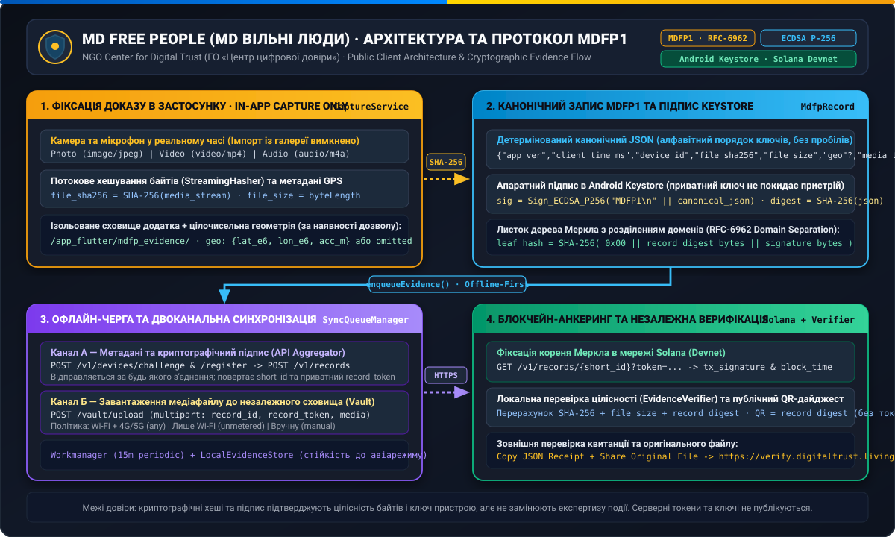
</p>

### Інтерактивна схема потоків даних

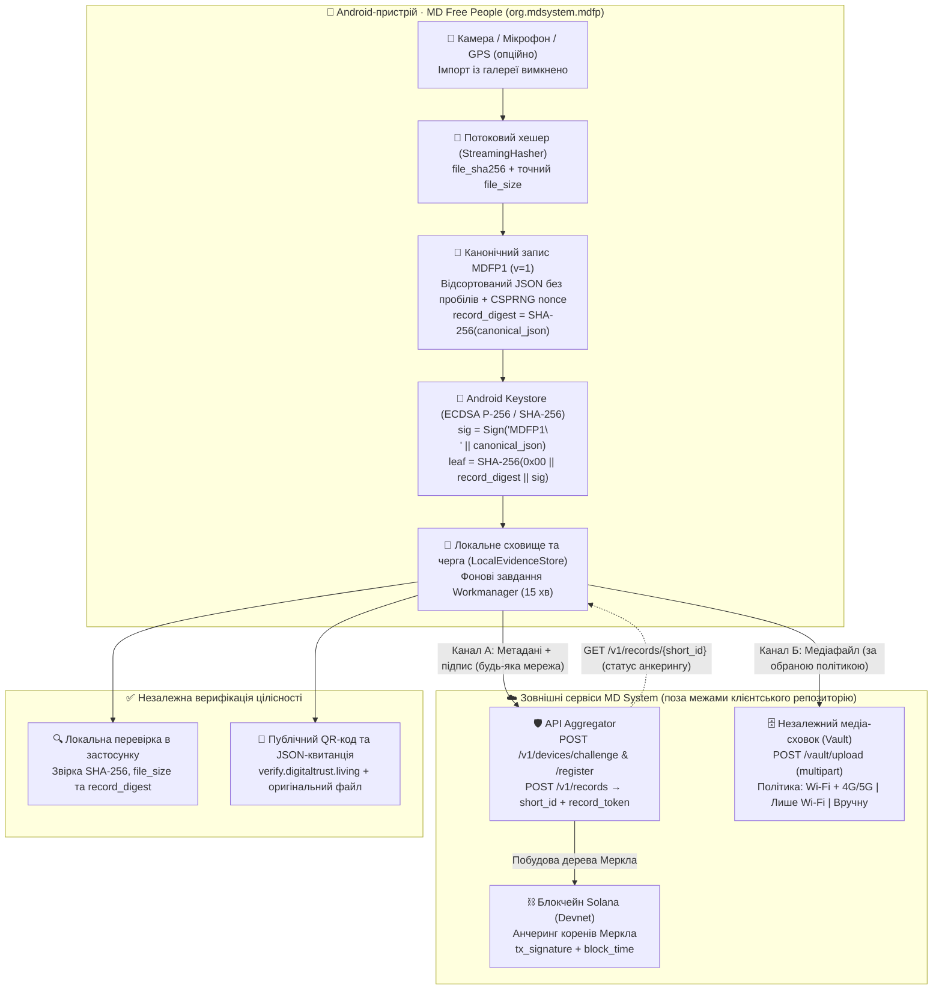

### Криптографічна модель запису (`MDFP1`)

```text
file_sha256      = SHA-256(raw_media_bytes)
canonical_json   = '{"app_ver":...,"client_time_ms":...,"device_id":...,"file_sha256":...,"file_size":...,"geo":?...,"media_type":...,"nonce":...,"v":1}'
record_digest    = SHA-256(utf8(canonical_json))
signature        = ECDSA_P256_SHA256_Sign(key = AndroidKeystore, msg = "MDFP1\n" || utf8(canonical_json))
merkle_leaf_hash = SHA-256(0x00 || hex_decode(record_digest) || base64_decode(signature))
```

---

## Інтерфейс застосунку (Скріншоти)

### 1. Онбординг, дозволи та жива фіксація

| Онбординг і вибір мови | Пояснення дозволів | Системний дозвіл геолокації |
| :---: | :---: | :---: |
| 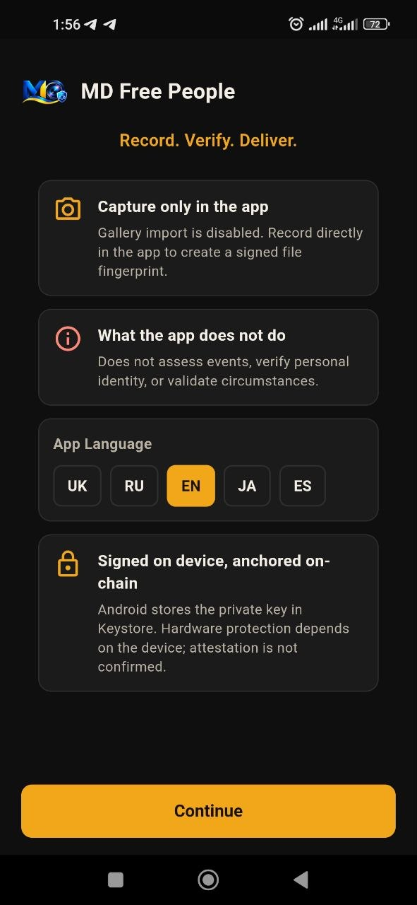 | 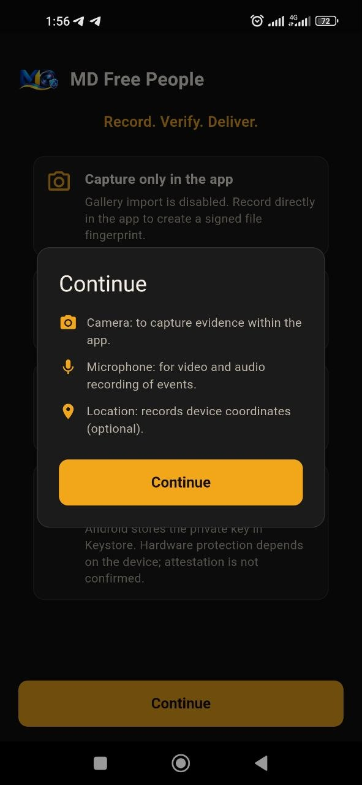 | 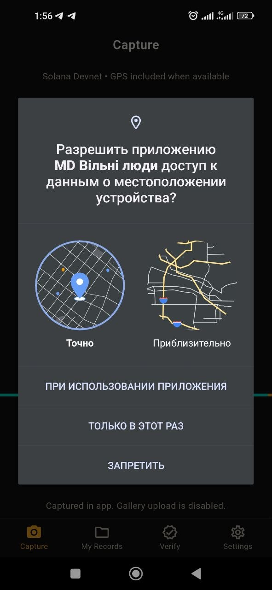 |
| Правила фіксації в застосунку, межі застосування та миттєвий вибір мови (`UK`, `RU`, `EN`, `JA`, `ES`). | Прозоре пояснення призначення камери, мікрофона та опціональних координат GPS. | Стандартний системний запит Android на точну або приблизну геолокацію. |

### 2. Зйомка, деталі запису, QR-дайджест та JSON-квитанція

| Екран фіксації (Фото / Відео / Аудіо) | Деталі запису та публічний QR-дайджест | Експорт JSON-квитанції та файлу |
| :---: | :---: | :---: |
| 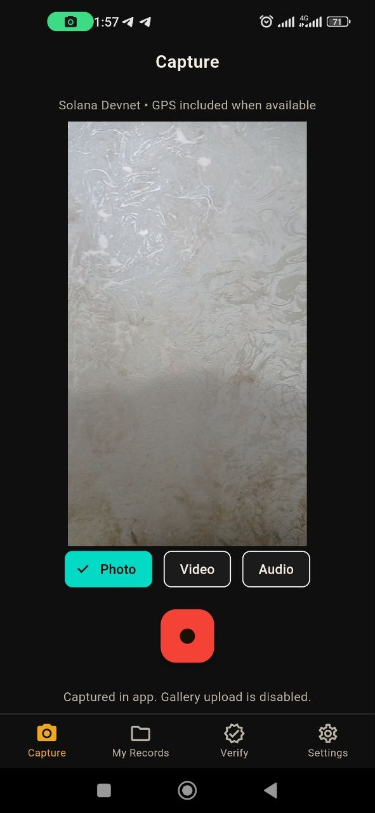 | 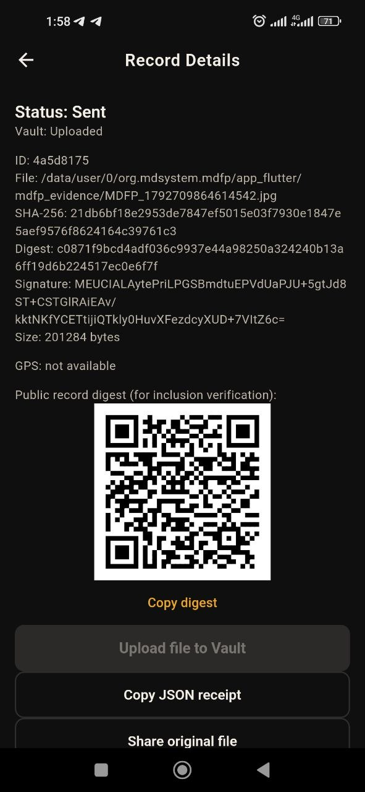 | 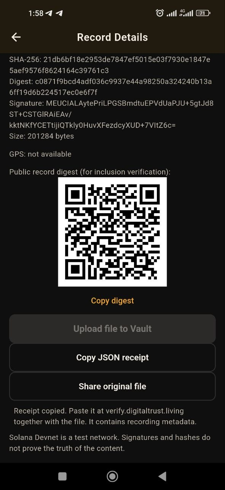 |
| Живий видошукач, перемикання режимів `Photo` / `Video` / `Audio` та індикація мережі. | Відображення статусів `Sent` / `Vault: Uploaded`, `SHA-256`, `Digest`, підпису `ECDSA` та QR-коду дайджесту. | Ручне завантаження у Vault, копіювання JSON-квитанції для `verify.digitaltrust.living` і шеринг оригіналу. |

### 3. Перевірка цілісності та налаштування

| Локальна перевірка цілісності | Мова інтерфейсу та політика завантаження | Безпека даних і паспорт протоколу |
| :---: | :---: | :---: |
| 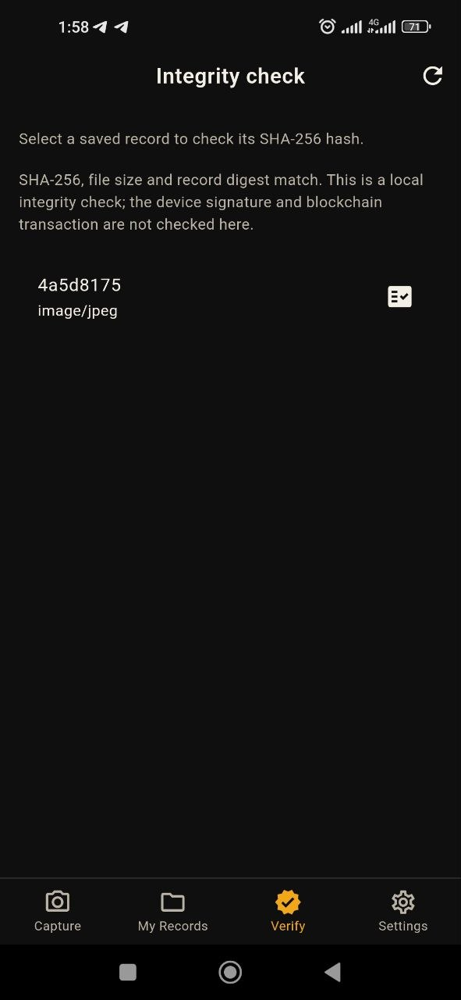 | 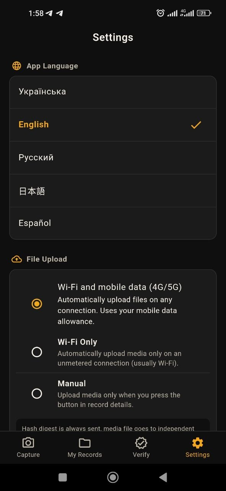 | 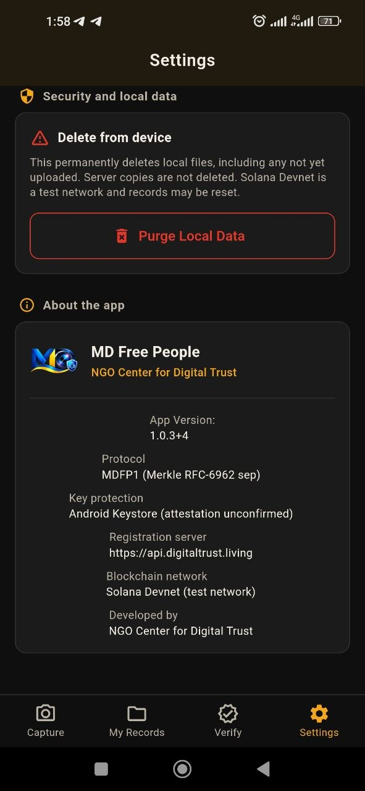 |
| Автономна перевірка відповідності `SHA-256`, розміру файлу та канонічного дайджесту збереженого запису. | Вибір однієї з 5 мов і режиму відправки медіа: `Wi-Fi and mobile data (4G/5G)`, `Wi-Fi Only` або `Manual`. | Очищення локального сховища на пристрої та технічна інформація про протокол `MDFP1` і сервери. |

---

## Початок роботи

Встановіть **Flutter 3.24.5**, **Java 17** та **Android SDK** (`platforms;android-35`, `build-tools;34.0.0`). У корені репозиторію виконайте:

```sh
flutter pub get && flutter analyze --no-pub && flutter test --no-pub
```

- Для запуску на підключеному Android-пристрої: `flutter run`
- Для збірки тестового APK: `flutter build apk --release --no-pub`
- Докладні команди, конфігурація серверів (`--dart-define=API_BASE_URL=...`, `--dart-define=VAULT_BASE_URL=...`) і налаштування release-підпису — у [посібнику зі збірки](docs/BUILD.ru.md).

## Межі застосування

Перша реєстрація пристрою потребує доступного API. Після реєстрації записи можуть очікувати синхронізації локально. Android може відкладати фонові завдання; 15 хвилин — інтервал планування, а не гарантований час доставки.

Хешування перевіряє цілісність байтів, але саме по собі не доводить правдивість події, координат чи часу. Апаратний захист ключа залежить від пристрою. Поточна серверна інтеграція використовує **Solana Devnet** — тестову мережу. Код серверів Azure, Vault та агрегатора не входить до цього репозиторію.

Базова версія `1.0.3` пройшла 27 автоматичних тестів та статичний аналіз. Фізичний тест 4G із SIM-карткою до цих перевірок не входив. GitHub Actions запускається автоматично при публікації змін у репозиторії.

---

## Независимая оценка

С инженерной и архитектурной точек зрения приложение спроектировано зрело, прагматично и без «крипто-маркетинговой мишуры» — с прицелом на реальные полевые условия, работу в офлайне и строгую воспроизводимость криптографических отпечатков.

### 1. Грамотная криптографическая спецификация (`MDFP1`)
- **Детерминированный канонический JSON** (`lib/core/protocol/mdfp_record.dart`): ключи строго отсортированы по алфавиту, нет пробелов, а координаты GPS (`MdfpGeo`) переводятся в целые микроградусы (`lat_e6`, `lon_e6`, `acc_m`). Это исключает классическую проблему плавающей точки (`float`), из-за которой на разных языках и процессорах JSON-сериализация часто даёт разный `SHA-256`. При отсутствии геолокации поле `geo` чисто опускается без подстановки нулей.
- **Защита дерева Меркла по стандарту RFC-6962**: в `CaptureService.computeMerkleLeaf` используется префикс листа `0x00` (`SHA-256(0x00 || record_digest || signature_bytes)`), а при подписи в Keystore — доменный префикс `"MDFP1\n"`. Это защищает от подмены узлов дерева Меркла (second-preimage attacks).
- **Потоковое хеширование (`StreamingHasher`)**: файл хешируется потоком байтов сразу после закрытия записи, поэтому даже длинные видео не вызывают переполнения памяти (`OutOfMemory`) на бюджетных смартфонах.

### 2. Разделение каналов доставки (Split-Channel & Offline-First)
В `SyncQueueManager` (`lib/core/queue/sync_queue_manager.dart`) реализовано ключевое для полевой работы решение — **разделение лёгкого криптографического отпечатка и тяжёлого медиафайла**:
- **Канал А (Агрегатор)**: компактный JSON и подпись уходят при первом же появлении даже слабой сети (`EDGE/3G/4G`), мгновенно фиксируя факт и время существования файла в очереди на блокчейн-анкеринг.
- **Канал Б (Vault)**: само видео или фото объёмом в десятки мегабайт не блокирует фиксацию доказательства и догружается отдельно в независимое хранилище по выбранной политике (`Wi-Fi + 4G/5G`, `Только Wi-Fi` или `Вручную`).

### 3. Безопасность на уровне продуманных мелочей
- **Запрет импорта из галереи**: отсекает базовый вектор фальсификации с подписью заранее отредактированного файла.
- **Разделение публичного и приватного в UI**: QR-код на экране деталей записи отдаёт только публичный `record_digest` для проверки включения, но **не раскрывает** приватный `record_token` (посторонний человек, сфотографировавший экран, не получит токен доступа к записи).
- **Аппаратный Android Keystore**: приватный ключ (`ecdsa-p256-sha256`) через `AndroidKeystoreSigner` не извлекается из системного хранилища.

### 4. Честность границ доверия (Trust Boundaries)
И в онбординге (`OnboardingScreen`), и в документации прямо зафиксировано, что делает и чего **не** делает приложение: криптография доказывает целостность байтов и подпись ключом устройства в момент фиксации, но не заменяет экспертизу обстоятельств самой сцены. Для юристов, расследователей и аудиторов безопасности такая прозрачность вызывает намного больше доверия, чем обещания «абсолютной истины на блокчейне».

### Перспективные направления развития (v1.1 / v2.0)
1. **Серверная проверка Android Key Attestation**: в `AndroidKeystoreSigner.getAttestationChain` метод получения цепочки сертификатов уже заложен — его проверка на сервере при регистрации устройства позволит криптографически подтверждать генерацию ключа внутри аппаратного чипа (`TEE` / `StrongBox`).
2. **Возобновляемая (chunked) загрузка в Vault**: догрузка крупных видеофайлов по частям при обрывах мобильной сети.
3. **Переход с Solana Devnet на Mainnet** (или настраиваемый профиль сети) при выходе в промышленную эксплуатацию.

---

## Документація

- [Архітектура і потоки даних](docs/ARCHITECTURE.md)
- [Независимая оценка (RU)](docs/ASSESSMENT.ru.md)
- [English README](docs/README.en.md)
- [Збірка, конфігурація та підпис (RU)](docs/BUILD.ru.md)
- [Локалізація](docs/LOCALIZATION.md)
- [Внесення змін](CONTRIBUTING.md)
- [Політика безпеки](SECURITY.md)
- [Публікація репозиторію](docs/GITHUB.ru.md)
- [Результати перевірки цієї копії](docs/VALIDATION.md)
- [Ліцензія MIT](LICENSE) · [Сторонні компоненти](THIRD_PARTY_NOTICES.md)

---

Власний код проєкту поширюється за [ліцензією MIT](LICENSE). Авторські права: **© 2026 NGO Center for Digital Trust (ГО «Центр цифрової довіри»)**. Ліцензії сторонніх компонентів збережено окремо.
