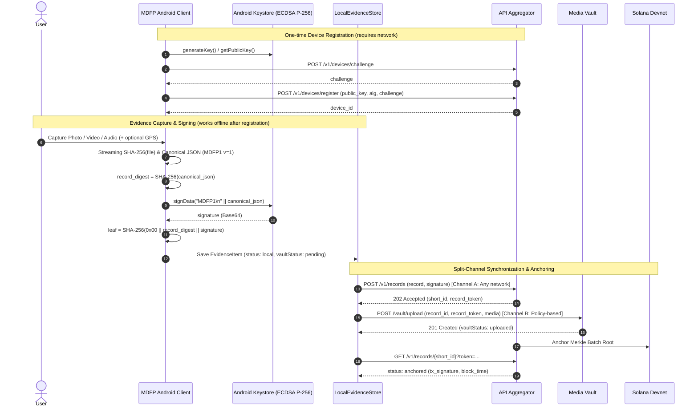

# Architecture

This repository contains an Android Flutter client (`org.mdsystem.mdfp`), not the Azure backend or Solana anchor service.

<p align="center">
  
</p>

## Repository Layout

```text
lib/screens/             UI, capture, records, settings, onboarding
lib/core/capture/        capture orchestration and local integrity checks
lib/core/protocol/       canonical record model (MDFP1)
lib/core/crypto/         hashing and platform signer interface
lib/core/storage/        local records and serialized writes
lib/core/queue/          API synchronization, upload policy, Workmanager
lib/core/localization/   locale persistence and generated catalogs
lib/l10n/                five source ARB catalogs
android/app/src/main/    Keystore, recording and sharing integration
test/                    integrity, storage, upload and UI regression tests
tool/                    translation generation
docs/images/             public architecture diagrams
docs/screenshots/        application UI screenshots
```

## Record Lifecycle & Sequence Diagram

1. Initialize a signing key in Android Keystore (`ecdsa-p256-sha256`) and register the device with the API. First registration needs a connection.
2. Capture media directly in the app, stream its `SHA-256` hash, create a deterministic canonical `MDFP1` JSON record, compute its `record_digest`, and sign `"MDFP1\n" || canonical_json`.
3. Persist the media reference and signed record in the local store (`LocalEvidenceStore`).
4. Submit the canonical record and signature to the aggregator (`POST /v1/records`); retain its `short_id` and private `record_token`.
5. Upload multipart media to Vault (`POST /vault/upload`) according to the selected upload policy (`any`, `wifi`, or `manual`).
6. Poll status (`GET /v1/records/{short_id}?token=...`) and display server-provided blockchain receipt information (`tx_signature`, `block_time`).



The QR code exposes the `record_digest`, not the private `record_token`. Media upload and record synchronization have separate statuses. Local verification recalculates the file hash, byte length and canonical-record digest; it does not independently validate blockchain finality or prove the scene's truth.

## Client Routes

| Method | Route | Purpose |
| --- | --- | --- |
| POST | `/v1/devices/challenge` | Registration challenge |
| POST | `/v1/devices/register` | Public key, algorithm and challenge |
| POST | `/v1/records` | Canonical record and signature |
| GET | `/v1/records/{short_id}?token=...` | Record status |
| POST | Vault base URL + `/upload` | Multipart `record_id`, `record_token`, `media` |

These routes describe the implemented client, not a complete server specification. Use HTTPS. Never paste token-bearing URLs into public issues.

## Background Work

Connected and unmetered workers are scheduled at 15-minute intervals; Android controls execution time. Policy `any` permits cellular; `wifi` uses the unmetered constraint, not a guarantee of a radio technology; `manual` disables automatic media upload. Metadata synchronization remains separate. The migration preserves manual mode and changes the old automatic Wi-Fi default to connected networks once.

## Trust Boundaries

Keystore protection depends on the device. Non-Android software signing is a test facility. Location and clock are inputs, not independently verified facts. API/Vault and Solana Devnet depend on external services. Source publication excludes stored evidence, access tokens and deployment credentials.
