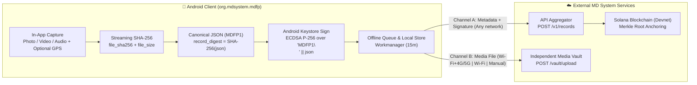

<p align="center">
  
</p>

<h1 align="center">MDFP · MD Free People</h1>

<p align="center">
  <a href="../README.md">Українська</a> ·
  <a href="BUILD.ru.md">Build instructions (Russian)</a> ·
  <a href="ARCHITECTURE.md">Architecture</a>
</p>

An Android application for capturing photos, video and audio directly on the device, verifying cryptographic byte integrity under the **MDFP1** protocol, and submitting signed records and media to MD System services.

**Developed by NGO Center for Digital Trust — ГО “Центр цифрової довіри”.**

Version **1.0.3+4** · Android **8.0+** (target API 35) · package **org.mdsystem.mdfp**.

- **Prebuilt Test APK:** [`MDFP-1.0.3-test.apk`](../MDFP-1.0.3-test.apk) (`73.86 MB`, `77,451,351` bytes)
- **SHA-256:** `ff780ce202649b98cc0b319631da8dc6ff4118413812bbe20500f0d57fd3d78b`

---

## Public Architecture & MDFP1 Protocol Diagram

<p align="center">
  
</p>



## Features

The app hashes captured media and a canonical record with `SHA-256`, signs records using **Android Keystore** (`ecdsa-p256-sha256`), computes an RFC-6962 domain-separated Merkle leaf (`0x00 || record_digest || signature`), stores an offline-resilient local queue, submits metadata to the API aggregator, and uploads media to an independent Vault. Users can choose connected networks (including cellular 4G/5G), unmetered networks (`Wi-Fi Only`), or manual upload. The UI supports **Ukrainian, English, Russian, Spanish and Japanese** and persists the selected language.

---

## Application Screenshots

| Onboarding & Language Selection | Permission Rationale | System Location Permission |
| :---: | :---: | :---: |
|  |  |  |

| Live Capture (Photo / Video / Audio) | Record Details & Public QR Digest | Receipt & Media Export |
| :---: | :---: | :---: |
|  |  |  |

| Local Integrity Check | Language & Upload Policy | Security & Protocol Info |
| :---: | :---: | :---: |
|  |  |  |

---

## Development

The validated toolchain is Flutter 3.24.5 / Dart 3.5.4, Java 17, Android SDK platform 35 and build-tools 34.0.0. From the repository root:

```sh
flutter pub get && flutter analyze --no-pub && flutter test --no-pub
```

`flutter run` starts the app on an Android device. `flutter build apk --release --no-pub` creates a locally debug-signed test APK unless a release key configuration is supplied. See [build and signing](BUILD.ru.md).

## Scope

Initial registration needs network access. Android may defer uploads. Hashes establish byte integrity, not the truth of an event; hardware key protection depends on the phone. Solana Devnet is a test network. Backend services are separate from this repository.

The baseline passed static analysis and 27 tests; no physical SIM-based 4G test was performed.

## Independent Assessment

1. **Deterministic Cryptographic Protocol (`MDFP1`)**: Canonical JSON (`MdfpRecord`) uses lexicographically sorted keys, zero whitespace, and integer micro-degrees (`lat_e6`, `lon_e6`, `acc_m`) to eliminate cross-platform floating-point drift. Domain separation is enforced both at signing (`"MDFP1\n"`) and at Merkle leaf construction (`0x00` prefix per RFC-6962). `StreamingHasher` hashes media streams without loading large videos into RAM.
2. **Split-Channel Offline-First Delivery (`SyncQueueManager`)**: Lightweight canonical metadata and signatures are dispatched over any available connection (`Channel A`) to secure an immediate timestamp and queue blockchain anchoring, while heavy media files (`Channel B`) are uploaded independently to Vault under user-controlled network policies (`Wi-Fi + 4G/5G`, `Wi-Fi Only`, or `Manual`).
3. **Defense-in-Depth UX & Keystore Isolation**: Gallery import is disabled by design; private keys (`ecdsa-p256-sha256`) stay inside Android Keystore; public QR codes expose only `record_digest` and never leak the private `record_token`.
4. **Transparent Trust Boundaries**: Both the UI and documentation clearly state what cryptographic proofs establish (byte integrity and device key possession at capture time) and what they do not replace (independent verification of physical events).

See [architecture](ARCHITECTURE.md), [independent assessment (RU)](ASSESSMENT.ru.md), [contribution guide](../CONTRIBUTING.md), [security](../SECURITY.md), and [licensing details](LICENSING.md). Original project code is licensed under the [MIT License](../LICENSE). Copyright (c) 2026 NGO Center for Digital Trust; third-party notices are preserved.
